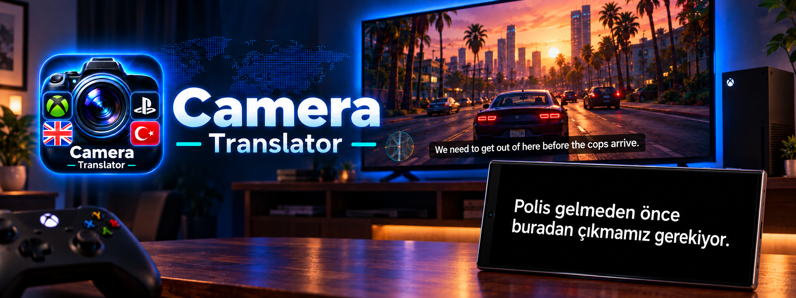

  

# 📷 Camera Translator

**Camera Translator**, öncelikli olarak **Xbox** ve **PlayStation** konsol oyuncuları için geliştirilmiş (isteğe bağlı PC oyunlarında da kullanılabilen), ekrandaki İngilizce altyazıları ve metinleri gerçek zamanlı olarak Türkçeye çeviren ve seslendiren açık kaynaklı bir kamera çeviri uygulamasıdır.

---

## ⚡ OPUS: Ücretsiz, İnternetsiz Çeviri Motoru

Camera Translator'ın varsayılan çeviri motoru **OPUS**'tur. Helsinki Üniversitesi'nin açık kaynaklı [OPUS-MT](https://huggingface.co/Helsinki-NLP/opus-mt-tc-big-en-tr) modeli, telefonda çalışacak şekilde sıkıştırılarak uygulamaya entegre edildi.

- 📶 **İnternet gerekmez:** Çeviri tamamen telefonunuzun içinde yapılır; uçak modunda bile çalışır.
- 🔑 **API anahtarı, kota ve ücret yok:** Sınırsız ve tamamen ücretsiz.
- ⚡ **Hızlı:** Ağ gecikmesi olmadığı için altyazı ekrana geldiği an çevrilir.
- 🎯 **Dürüst beklenti:** Günlük diyaloglarda çoğunlukla anlaşılır çeviriler verir. Ancak argo, deyimler ve OCR'ın hatalı okuduğu metinlerde hata yapabilir; bu konularda Google Translate genellikle daha doğrudur. Yaygın oyun argosunu (ör. hitap olarak "dog", "homes") düzeltmek için küçük bir argo sözlüğü kullanılır, ama her ifadeyi kapsamaz.
- 📦 **Tek seferlik kurulum:** Uygulamada Ayarlar → **⚡ OPUS Çeviri Motoru** → **İndir** (355 MB). İndirme yarıda kesilirse kaldığı yerden devam eder, dosyalar otomatik doğrulanır.

Uygulama ilk açılışta OPUS modunda başlar. OPUS İngilizce → Türkçe çeviri yapar; Türkçe → İngilizce yönünde ve model indirilmemişken Google ML Kit çevrimdışı motoru devreye girer (bu durumda çeviri kalitesi bir miktar düşer).

---

## 🌟 Öne Çıkan Özellikler

### 🌐 Çeviri Yöntemleri
- ⚡ **OPUS (varsayılan):** İnternetsiz ve ücretsiz cihaz içi çeviri (yukarıya bakın).
- 🌐 **Google Translate:** İnternet üzerinden ücretsiz çeviri; argo ve deyimlerde genellikle daha doğrudur, model indirmek istemeyenler için de hazır seçenektir.
- ☁️ **Google Cloud (isteğe bağlı):** Google Cloud Translation altyapısıyla çevrimiçi çeviri. Varsayılan olarak gizlidir; Ayarlar → **☁️ Google Cloud Çeviri** anahtarıyla açılır ve kendi API anahtarınızı gerektirir. Ücretsiz kullanım kotası ve fiyatlandırma koşulları Google Cloud'a bağlıdır.

### 🔊 Sesli Okuma & Altyazı Seslendirme (Dublaj)
- **Dahili Ses Motoru:** Google Translate tabanlı ücretsiz çevrimiçi seslendirme sunar.
- **Google Cloud Text to Speech (Chirp 3: HD):** İnsansı yapay zeka ses modelleri (`Kore`, `Puck`, `Charon` vb.) ile Kadın ve Erkek ses seçeneklerinde daha doğal ve akıcı seslendirme. Ücretsiz kullanım kotası ve fiyatlandırma koşulları Google Cloud'a bağlıdır. Çevrimiçi bağlantı ve API gerektirir.
- **Seslendirme Ayarları:** Her iki modda da seslendirmenin geride kalmaması için ayarlanabilir ses hızı.

### 📺 2 Farklı Çeviri Görünüm Modu
- 🎬 **Sinematik Altyazı:** Çeviriyi ekranın tam ortasında iri puntoyla gösterir, eski çeviriler yukarı kayar.

  

- Çeviri aktifken sağ kısımdaki **Göz** ikonuna basıldığında tüm arayüz gizlenir, odak artar.

  

- 📺 **Ekran Çevirisi:** Türkçe çeviriyi, orijinal altyazının üzerine konumlandırılan siyah bir şerit üzerinde gösterir.

  

- Çeviri aktif edildiğinde **Göz** ikonuna basılarak tüm arayüz gizlenebilir.

  

### 💡 Akıllı Kamera & Oyun İpuçları
- **Işık / Pozlama Düzeltmesi (☀️):** Karanlık odada TV altyazılarındaki parlamayı (blooming) söndürerek OCR okuma doğruluğunu ve netliğini belirgin şekilde artırır.
- **Hayalet / Göz Modu (👁️‍🗨️):** Ekrandaki tüm araç çubuklarını ve çerçeveleri gizler.
- **Zoom Kontrolü (1x - 5x):** Televizyona yaklaşmadan koltuktan rahat kullanım.
- **Manuel Odak + AUTO:** Uzaktaki TV'de yazı bulanıksa odak kaydırıcısıyla netliği elle ayarlayın; AUTO ile tek dokunuşta otomatik odağa dönün.
- **Beyaz Altyazı Filtresi:** Arka planı olmayan beyaz altyazılarda dokulu sahnelerin (ör. araba sürerken yol) okumayı bozmasını azaltır.
- **Bağımsız Mod Hafızası:** Dikey ve yatay ekran pozisyonları ile yazı boyutları her mod için bağımsız olarak saklanır.

---

## 📲 Kurulum ve İndirme

1. En güncel imzalı APK dosyasını [GitHub Releases](https://github.com/crosswindfighter/camera-translator/releases) sayfamızdan indirin.
2. Telefonunuza indirdiğiniz `camera-translator.apk` dosyasını kurun.
3. Uygulamayı açıp kamera iznini verin. İnternetsiz çeviri isterseniz ilk açılışta **⚡ OPUS** çeviri motorunu bir kez indirin (355 MB) — ya da dilerseniz Google Translate ile hemen başlayın.
4. Oyundaki altyazı alanını seçin ve çevirinin tadını çıkarın! Yeni sürümler yayınlandığında uygulama sizi bir kez bilgilendirir.

---

### ⚠️ Önemli Not: Metin Okuma (OCR) Hata Yapabilir

Camera Translator altyazıyı televizyon ekranından **kamerayla** okur; bu yüzden sonuç hiçbir zaman oyun içi bir çeviri kadar kusursuz olamaz. Dürüst olmak gerekirse:

- Kamera mesafesi, açı, odak, ekran parlaklığı ve yazı tipine bağlı olarak bazı kelimeler **yanlış okunabilir, eksik okunabilir veya hiç algılanmayabilir.**
- Altyazının arkasındaki **hareketli veya dokulu sahneler** (araba sürerken asfalt, karlı ya da parlak zeminler) okumayı özellikle zorlaştırır.
- Yanlış okunan metin **hatalı veya anlamsız çeviriye** dönüşebilir; ekranda çok kısa kalan altyazılar kaçabilir.

**Daha iyi sonuç için:** OCR alanını yalnızca altyazıyı kapsayacak şekilde daraltın, parlaklığı (☀️) biraz düşürün, gerekirse manuel odak kullanın. Oyununuz destekliyorsa **altyazı arka planını (siyah kutu) açmak** doğruluğu en çok artıran ayardır.

Camera Translator geliştirdiğim ilk Android uygulamasıdır. Karşılaştığınız hataları veya önerilerinizi [GitHub Issues](https://github.com/crosswindfighter/camera-translator/issues) üzerinden paylaşabilirsiniz (uygulamada: Hakkında → 🐞 Hata bildir).

---

### 🔒 Gizlilik

- **Kamera görüntüsü hiçbir yere gönderilmez.** Metin okuma (OCR) tamamen telefonda yapılır.
- **⚡ OPUS modunda çeviri de telefonda kalır;** hiçbir veri internete çıkmaz.
- **Google Translate ve Google Cloud modlarında** yalnızca okunan altyazı metni çeviri için Google'a gönderilir. Sesli okumada Google Cloud Text-to-Speech seçiliyse çevrilen metin seslendirme için Google'a gönderilir.
- API anahtarlarınız yalnızca telefonunuzda saklanır ve cihaz yedeklerine dahil edilmez.

---

### 🛡️ Güvenlik Bilgilendirmesi

Google Play Protect, uygulamayı tanımadığı veya yeterli itibara sahip olmadığı durumlarda kurulum sırasında uyarı gösterebilir. Uygulamanın en güncel v1.0.1 APK dosyası Kaspersky OpenTIP ile taranmış ve Clean (Temiz) sonucu alınmıştır. Bu sonuç tek başına mutlak güvenlik garantisi değildir.

🔗 [Kaspersky OpenTIP v1.0.1 tarama raporunu görüntüle](https://opentip.kaspersky.com/03591F4B4D2B92D7C7227316D645F9F592AAB089854983BC7009A6325EA93D36/results?tab=upload)

---

## 🤖 Geliştirme Notu & Teşekkür

Camera Translator, yapay zeka asistanlarıyla birlikte geliştirildi:

- **Google Gemini** — Uygulamanın temelleri Gemini ile atıldı: kamera, OCR, çeviri ve seslendirme altyapısı, arayüz ve ilk sürümler.
- **Claude (Anthropic)** — Uygulamanın bugünkü haline gelmesinde büyük pay sahibi. Claude ile birlikte:
  - ⚡ **OPUS çeviri motoru** sıfırdan geliştirildi: modelin seçilmesi ve gerçek oyun altyazılarıyla test edilmesi, telefonda çalışacak şekilde ONNX'e dönüştürülüp 355 MB'a sıkıştırılması, cihaz içi çeviri motorunun ve uygulama içi model indirme sisteminin yazılması,
  - 🔍 **OCR doğruluğu** iyileştirildi: dokulu arka planlar için beyaz altyazı filtresi, çift okuma ve güven tabanlı seçim, daha kararlı altyazı algılama,
  - 🌐 Google Translate modu hızlandırıldı,
  - 🔐 API anahtarı güvenliği güçlendirildi,
  - ✨ güncelleme bildirimi, manuel odak (AUTO), açık tema ve Ayarlar/Hakkında düzenlemeleri gibi sürüm hazırlıkları yapıldı.

Her iki asistana da geliştirme sürecindeki katkıları için teşekkür ederim. Fikirler, testler ve tüm kararlar bana ait; hataları ve eksikleri ise [GitHub Issues](https://github.com/crosswindfighter/camera-translator/issues) üzerinden bildirebilirsiniz.

---

## 📄 Lisans

Camera Translator, MIT lisansı altında yayımlanan açık kaynaklı bir projedir.

Bu lisans kapsamında kaynak kodu kullanılabilir, kopyalanabilir, değiştirilebilir ve dağıtılabilir. Lisansın gerektirdiği telif hakkı ve lisans bildirimleri korunmalıdır.

Lisansın tam metni için [LICENSE.md](LICENSE.md) dosyasına bakabilirsiniz.

Üçüncü taraf kütüphaneler, model ve hizmetler kendi lisans ve kullanım koşullarına tabidir; tam liste ve atıflar için [THIRD-PARTY-NOTICES.md](THIRD-PARTY-NOTICES.md) dosyasına bakın.

**OPUS çeviri motoru (model):** [Helsinki-NLP/opus-mt-tc-big-en-tr](https://huggingface.co/Helsinki-NLP/opus-mt-tc-big-en-tr) (Tiedemann & Thottingal, OPUS-MT / Tatoeba Challenge), [CC-BY 4.0](https://creativecommons.org/licenses/by/4.0/) lisansıyla. Uygulamanın indirdiği dosyalar bu modelin ONNX formatına çevrilmiş ve 8-bit sıkıştırılmış halidir; dönüştürme betikleri [tools/offline_model](tools/offline_model) klasöründedir. Model, [ONNX Runtime](https://onnxruntime.ai/) (MIT) ile çalıştırılır.
