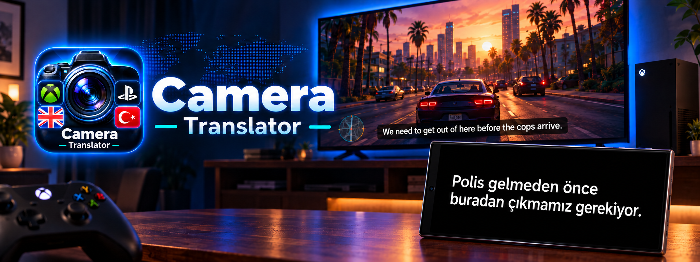

  

# 📷 Camera Translator

**Camera Translator**, öncelikli olarak **Xbox** ve **PlayStation** konsol oyuncuları için geliştirilmiş (isteğe bağlı PC oyunlarında da kullanılabilen), ekrandaki İngilizce altyazıları ve metinleri gerçek zamanlı olarak Türkçeye çeviren ve seslendiren açık kaynaklı bir kamera çeviri uygulamasıdır.

---

## ⚡ OPUS: Ücretsiz, İnternetsiz Çeviri Motoru

Camera Translator'ın varsayılan çeviri motoru **OPUS**'tur. Helsinki Üniversitesi'nin açık kaynaklı [OPUS-MT](https://huggingface.co/Helsinki-NLP/opus-mt-tc-big-en-tr) modeli temel alınarak altyazı verisiyle yeniden eğitildi ve telefonda çalışacak şekilde sıkıştırılarak uygulamaya entegre edildi.

- 📶 **İnternet gerekmez:** Çeviri tamamen telefonunuzun içinde yapılır; uçak modunda bile çalışır.
- 🔑 **API anahtarı, kota ve ücret yok:** Sınırsız ve tamamen ücretsiz.
- ⚡ **Hızlı:** Ağ gecikmesi olmadığı için altyazı ekrana geldiği an çevrilir.
- 🎯 **Dürüst beklenti:** Günlük diyaloglarda çoğunlukla anlaşılır çeviriler verir. Ancak argo, deyimler ve OCR'ın hatalı okuduğu metinlerde hata yapabilir; bu konularda Google Translate genellikle daha doğrudur. Yaygın oyun argosunu (ör. hitap olarak "dog", "homes") düzeltmek için küçük bir argo sözlüğü kullanılır, ama her ifadeyi kapsamaz.
- 📦 **Tek seferlik kurulum:** Uygulamada Ayarlar → **⚡ OPUS Çeviri Motoru** → **İndir** (355 MB). İndirme yarıda kesilirse kaldığı yerden devam eder, dosyalar otomatik doğrulanır.

Uygulama ilk açılışta OPUS modunda başlar. OPUS İngilizce → Türkçe çeviri yapar; Türkçe → İngilizce yönünde ve model indirilmemişken Google ML Kit çevrimdışı motoru devreye girer (bu durumda çeviri kalitesi bir miktar düşer).

---

## 🌟 Öne Çıkan Özellikler

### 🌐 Çeviri Yöntemleri
- ⚡ **OPUS (varsayılan):** İnternetsiz ve ücretsiz cihaz içi çeviri (yukarıya bakın).
- 🌐 **Google Translate:** İnternet üzerinden ücretsiz çeviri; argo ve deyimlerde genellikle daha doğrudur, model indirmek istemeyenler için de hazır seçenektir.
- ☁️ **Google Cloud (isteğe bağlı):** Google Cloud Translation altyapısıyla çevrimiçi çeviri. Varsayılan olarak gizlidir; Ayarlar → **☁️ Google Cloud Çeviri** anahtarıyla açılır ve kendi API anahtarınızı gerektirir. Ücretsiz kullanım kotası ve fiyatlandırma koşulları Google Cloud'a bağlıdır.

### 🔊 Sesli Okuma & Altyazı Seslendirme (Dublaj)
- **Dahili Ses Motoru:** Google Translate tabanlı ücretsiz çevrimiçi seslendirme sunar.
- **Google Cloud Text to Speech (Chirp 3: HD):** İnsansı yapay zeka ses modelleri (`Kore`, `Puck`, `Charon` vb.) ile Kadın ve Erkek ses seçeneklerinde daha doğal ve akıcı seslendirme. Ücretsiz kullanım kotası ve fiyatlandırma koşulları Google Cloud'a bağlıdır. Çevrimiçi bağlantı ve API gerektirir.
- **Seslendirme Ayarları:** Her iki modda da seslendirmenin geride kalmaması için ayarlanabilir ses hızı.

### 📺 Görünüm Modları
Ayarlar'da iki seçenek vardır: **📷 Kamera** (çevirinin Sinematik olarak mı yoksa televizyondaki yazının üstünde mi gösterileceği ayrıca seçilir) ve **📱 Ekran Çevirisi**. Ana ekrandaki mod düğmesi de aynı seçenekleri küçük bir menüde açar.

- 🎬 **Sinematik:** Çeviriyi iri ve net bir puntoyla gösterir. Akıllı akış, çevirileri OCR alanının konumuna göre kendiliğinden yönlendirir: OCR alanı aşağıdaysa yeni çeviri onun üstünde belirir ve geçmiş çeviriler yukarı doğru yumuşakça akar; OCR alanı yukarıdaysa yeni çeviri onun altında belirir ve geçmiş çeviriler aşağı doğru yumuşakça akar. Geçmiş çeviriler küçülerek ekranın kenarında kararıp kaybolur ve hiçbir zaman altyazının üstüne binmez. İsterseniz Ortadan akış seçilebilir: çeviri, OCR alanının yerinden bağımsız olarak ekranın ortasında belirir, geçmiş çeviriler yukarı doğru akar. Görünen satır sayısı (1–20) ayarlanabilir. Göz modunda son çeviri, bir bakışta okunsun diye ekrana sığan en büyük boyuta çıkar; bu, Ayarlar'dan kapatılabilir.
- 📺 **Yazının üstünde:** OCR alanı şeffaftır; Türkçe çeviri, İngilizce yazının tam üstünde, yazıyı saran siyah bir kutuda beyaz yazıyla gösterilir ve orijinal yazıyı örter. Yazı boyutu ekrandaki İngilizce yazıya göre kendiliğinden ayarlanır; Başlat'a basınca OCR alanının çerçevesi gizlenir, duraklatınca alan yeniden ayarlanabilir; uzun çevirilerde kutu büyür ama düğmelerin üstüne binmez. Yazı 5 saniye görünmezse çeviri kaybolur. Ayarlar'dan en fazla **3 OCR alanı** kullanılabilir (ör. biri altyazı, diğerleri görev ve bilgi mesajları için); her alan kendi yazısını ayrı çevirir ve konumu dikey/yatay için ayrı kaydedilir.
- 📱 **Ekran Çevirisi:** Kamera kullanmaz; telefonun kendi ekranını okur ve oyunun üstüne, İngilizce yazının tam yerine Türkçesini yazar. Asıl gücü Samsung DeX'te: Samsung telefonunuzu kabloyla televizyona bağlayıp DeX'te Xbox Remote Play'i açtığınızda oyun büyük ekranda çok net görünür; Türkçe altyazılar doğrudan İngilizce altyazının üstüne gelir ve televizyonda görünür. Oyunu televizyonda, sanki orijinal Türkçe altyazılıymış gibi oynarsınız. Telefonda oynanan oyunlarda da çalışır. PS Remote Play bu modda çalışmaz: Sony, oyun görüntüsünü ekran paylaşımına kapatıyor ve uygulamaya yalnızca siyah görüntü geliyor. PlayStation oyunları için Kamera modunu ya da aşağıdaki liste görünümünü kullanın; Xbox Remote Play'de böyle bir kısıtlama yoktur, sorunsuz çalışır. DeX'e kablosuz (Smart View ile) bağlanmak bu modla çalışmaz: kablosuz DeX de telefonun ekran paylaşımını kullandığı için ikisi çakışır ve biri kapanır. Başlat'a basın, ekran paylaşımında "Tek bir uygulamayı paylaş" seçeneğiyle oyunu ya da Remote Play uygulamasını seçin; OCR alanlarını oyunun içinden, ekranın kenarındaki yüzen balonla yerleştirin. Oyunu oynarken çeviriler dokunmayı engellemez. Liste görünümü: çeviri oyunun üstüne yazılmak yerine telefonda akan iri puntolu bir liste olarak gösterilir. Oyunu televizyonda oynayıp kaçırdığınız replikleri telefondan okumak içindir; PlayStation'da konsoldan Twitch ya da YouTube'a yayın açıp telefonda o yayını paylaşarak bu modu kullanabilirsiniz. Ayarlar'dan ya da oyunun içinde yüzen düğmeden açılır.

### 💡 Akıllı Kamera & Oyun İpuçları
- **Işık / Pozlama Düzeltmesi (☀️):** Karanlık odada TV altyazılarındaki parlamayı (blooming) söndürerek OCR okuma doğruluğunu ve netliğini belirgin şekilde artırır. Kaydırıcının alt kısmındaki mor bölge ekstra karartmadır.
- **Hayalet / Göz Modu (👁️‍🗨️):** Ekrandaki tüm araç çubuklarını ve çerçeveleri gizler.
- **Zoom Kontrolü:** Sınırları telefonun kamerasına göre kendiliğinden ayarlanan kaydırıcı ya da 1x–5x sabit düğmeler; televizyona yaklaşmadan koltuktan rahat kullanım.
- **Manuel Odak + AUTO:** Uzaktaki TV'de yazı bulanıksa odak kaydırıcısıyla netliği elle ayarlayın; AUTO ile tek dokunuşta otomatik odağa dönün.
- **Beyaz Altyazı Filtresi:** Arka planı olmayan beyaz altyazılarda dokulu sahnelerin (ör. araba sürerken yol) okumayı bozmasını azaltır.
- **Bağımsız Mod Hafızası:** Dikey ve yatay ekran pozisyonları ile yazı boyutları her mod için bağımsız olarak saklanır.
- **Çeviri Geçmişi:** Uygulama açık olduğu sürece çevrilen altyazılar İngilizceleriyle birlikte menüden görüntülenebilir; kaçırdığınız cümlelere sonradan bakabilirsiniz (telefona kaydedilmez).
- **Kendini Denetleyen Çeviri:** OPUS'un yarım kalan ya da bozuk görünen çevirileri otomatik olarak daha dikkatli bir yöntemle yeniden denenir.
- **Uygulama İçinden Güncelleme:** Yeni sürüm çıktığında uygulama sizi bilgilendirir; güncelleme uygulamanın içinden indirilip tek dokunuşla kurulur. Güncellemeden sonraki ilk açılışta yenilikler gösterilir.
- **Nasıl Kullanılır:** Menüdeki bu sayfada A'dan Z'ye kullanım, taktikler ve sık sorulan sorular bulunur.
- **İlk Açılış Rehberi:** Uygulamanın düğmelerini adım adım tanıtır; Hakkında ekranından tekrar açılabilir.

---

## 📲 Kurulum ve İndirme

1. En güncel imzalı APK dosyasını [GitHub Releases](https://github.com/crosswindfighter/camera-translator/releases) sayfamızdan indirin.
2. Telefonunuza indirdiğiniz APK dosyasını (ör. `camera-translator-v1.1.5.apk`) kurun.
3. Uygulamayı açıp kamera iznini verin. İnternetsiz çeviri isterseniz ilk açılışta **⚡ OPUS** çeviri motorunu bir kez indirin (355 MB) — ya da dilerseniz Google Translate ile hemen başlayın.
4. Oyundaki altyazı alanını seçin ve çevirinin tadını çıkarın! Yeni sürümler yayınlandığında uygulama sizi bir kez bilgilendirir.

### 🛠️ APK Kurulmuyorsa ("Paket ayrıştırılamadı", "Dosya bozuk", "Paket geçersiz")

Bu hatanın en sık nedeni dosyanın eksik inmesidir. Sırayla şunları deneyin:

1. **Dosya boyutuna bakın.** İndirdiğiniz dosya, Releases sayfasında yazan boyuttan belirgin şekilde küçükse indirme yarım kalmıştır. Telefonlar boyutu birkaç MB farklı gösterebilir (ör. 112 MB yerine 117 MB), bu normaldir.
2. **Eski dosyayı silip Chrome ile yeniden indirin.** Bağlantıyı YouTube gibi bir uygulamanın kendi tarayıcısında açmak yerine kopyalayıp Chrome'a yapıştırın.
3. **Telefonunuzun desteklendiğinden emin olun.** Android 7 veya üstü ve ARM işlemci gerekir; Intel/x86 işlemcili cihazlar ve bazı bilgisayar emülatörleri desteklenmez.
4. **Boş alanı kontrol edin.** Kurulum için APK boyutunun en az iki katı kadar boş alan bırakın.
5. **Kurulum izinlerine bakın.** Tarayıcınızın ya da dosya yöneticinizin bilinmeyen uygulama yükleme izni açık olmalı. Samsung'da Otomatik Engelleyici açıksa kurulumu engelleyebilir.
6. **Uygulama içi güncelleme başarısız olursa** yeni sürümün APK'sını Releases sayfasından indirip kurun.

Sorun sürerse telefon modelinizi, Android sürümünüzü, dosya boyutunu ve hata mesajını [Issues](https://github.com/crosswindfighter/camera-translator/issues) bölümüne yazın.

### 🐞 Sorun Bildirme

1. Uygulamada Hakkında ekranını açıp sürüm yazısına 7 kez dokunun; geliştirici modu açılır ve uygulama kayıt almaya başlar.
2. Uygulamayı sorunun yaşandığı şekilde kullanın.
3. Hakkında'ya dönüp **Kaydı paylaş**'a basın; kayıt küçük bir zip dosyası olarak hazırlanır. **Kaydı indir** ile aynı dosyayı telefonun İndirilenler klasörüne de kaydedebilirsiniz.
4. [Issues](https://github.com/crosswindfighter/camera-translator/issues) sayfasında sorunu anlatın ve zip dosyasını ekleyin.

Kayıtta okunan altyazılar, çeviriler, telefon modeli, Android sürümü ve uygulama ayarları bulunur; kamera görüntüleri dosyaya eklenmez.

---

### ⚠️ Önemli Not: Metin Okuma (OCR) Hata Yapabilir

Camera Translator altyazıyı televizyon ekranından **kamerayla** okur; bu yüzden sonuç hiçbir zaman oyun içi bir çeviri kadar kusursuz olamaz. Dürüst olmak gerekirse:

- Kamera mesafesi, açı, odak, ekran parlaklığı ve yazı tipine bağlı olarak bazı kelimeler **yanlış okunabilir, eksik okunabilir veya hiç algılanmayabilir.**
- Altyazının arkasındaki **hareketli veya dokulu sahneler** (araba sürerken asfalt, karlı ya da parlak zeminler) okumayı özellikle zorlaştırır.
- Yanlış okunan metin **hatalı veya anlamsız çeviriye** dönüşebilir; ekranda çok kısa kalan altyazılar kaçabilir.
- **Bu risk her zaman vardır ve tamamen ortadan kaldırılamaz.** Ekrandaki görüntüyü kamerayla okuyan her uygulamanın doğal bir sınırıdır; uygulamadaki iyileştirmeler hata oranını azaltır ama sıfırlamaz.

**Daha iyi sonuç için:** OCR alanını yalnızca altyazıyı kapsayacak şekilde daraltın, parlaklığı (☀️) biraz düşürün, gerekirse manuel odak kullanın. Oyununuz destekliyorsa **altyazı arka planını (siyah kutu) açmak** doğruluğu en çok artıran ayardır.

Camera Translator geliştirdiğim ilk Android uygulamasıdır. Karşılaştığınız hataları veya önerilerinizi [GitHub Issues](https://github.com/crosswindfighter/camera-translator/issues) üzerinden paylaşabilirsiniz (uygulamada: Hakkında → 🐞 Hata bildir).

---

### 🔒 Gizlilik

- **Kamera görüntüsü hiçbir yere gönderilmez.** Metin okuma (OCR) tamamen telefonda yapılır.
- **⚡ OPUS modunda çeviri de telefonda kalır;** hiçbir veri internete çıkmaz.
- **Google Translate ve Google Cloud modlarında** yalnızca okunan altyazı metni çeviri için Google'a gönderilir. Sesli okumada Google Cloud Text-to-Speech seçiliyse çevrilen metin seslendirme için Google'a gönderilir.
- API anahtarlarınız yalnızca telefonunuzda saklanır ve cihaz yedeklerine dahil edilmez.

---

## 🤖 Geliştirme Notu & Teşekkür

Camera Translator'ın temelleri **Google Gemini** ile atıldı; uygulama sonrasında **Claude (Anthropic)** ile geliştirildi.

- **Google Gemini** — Kamera, OCR, çeviri ve seslendirme altyapısı, arayüz ve ilk sürümler (v1.0.0 – v1.0.1).
- **Claude (Anthropic)** — v1.0.2'den itibaren gelen geliştirmelerin büyük bölümü. Fikirler, testler ve kararlar bana aittir.

Sürüm sürüm değişiklik listesi [Releases](https://github.com/crosswindfighter/camera-translator/releases) sayfasındadır.

#### 🔐 Güvenlik
- Google Cloud API anahtarı URL yerine istek başlığıyla gönderiliyor; anahtar Google Cloud konsolunda yalnızca bu uygulamaya (paket adı + imza) kısıtlanabiliyor.
- API anahtarları cihaz yedeklerine dahil edilmiyor; APK'ya anahtar gömülmüyor.
- OPUS modeli uygulamanın özel depolama alanında tutuluyor (başka uygulamalar erişemiyor); güncelleme bildirimi yalnızca bu reponun sayfalarını açıyor.

Her iki asistana da geliştirme sürecindeki katkıları için teşekkür ederim. Hataları ve önerileri [GitHub Issues](https://github.com/crosswindfighter/camera-translator/issues) üzerinden bildirebilirsiniz.

---

## 📄 Lisans

Camera Translator, MIT lisansı altında yayımlanan açık kaynaklı bir projedir.

Bu lisans kapsamında kaynak kodu kullanılabilir, kopyalanabilir, değiştirilebilir ve dağıtılabilir. Lisansın gerektirdiği telif hakkı ve lisans bildirimleri korunmalıdır.

Lisansın tam metni için [LICENSE.md](LICENSE.md) dosyasına bakabilirsiniz.

Üçüncü taraf kütüphaneler, model ve hizmetler kendi lisans ve kullanım koşullarına tabidir; tam liste ve atıflar için [THIRD-PARTY-NOTICES.md](THIRD-PARTY-NOTICES.md) dosyasına bakın.

**OPUS çeviri motoru (model):** [Helsinki-NLP/opus-mt-tc-big-en-tr](https://huggingface.co/Helsinki-NLP/opus-mt-tc-big-en-tr) (Tiedemann & Thottingal, OPUS-MT / Tatoeba Challenge), [CC-BY 4.0](https://creativecommons.org/licenses/by/4.0/) lisansıyla. Uygulamanın indirdiği dosyalar bu modelin OpenSubtitles altyazı çiftleriyle yeniden eğitilmiş, ONNX formatına çevrilmiş ve 8-bit sıkıştırılmış halidir; dönüştürme betikleri [tools/offline_model](tools/offline_model) klasöründedir. Model, [ONNX Runtime](https://onnxruntime.ai/) (MIT) ile çalıştırılır.
